

  <a href="https://jayashreemondal-portfolio.netlify.app/">
    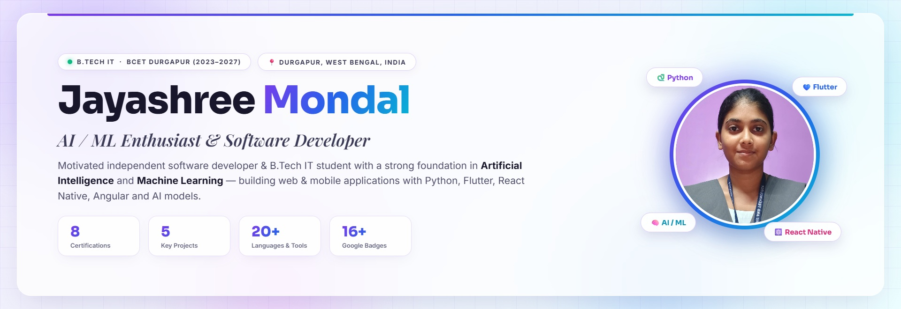
  </a>

    

  

   

  

    &nbsp;
    &nbsp;
    &nbsp;
    &nbsp;
    &nbsp;
    
  

  

    
      <a href="#-about-me">About</a> &nbsp;·&nbsp;
      <a href="#-featured-projects">Projects</a> &nbsp;·&nbsp;
      <a href="#-skills--toolbox">Skills</a> &nbsp;·&nbsp;
      <a href="#-my-journey">Journey</a> &nbsp;·&nbsp;
      <a href="#-arcade--take-a-break">Play a Game</a> &nbsp;·&nbsp;
      <a href="#-activity--stats">Activity &amp; Snake</a> &nbsp;·&nbsp;
      <a href="#-licenses--certifications">Certifications</a> &nbsp;·&nbsp;
      <a href="#-get-in-touch">Contact</a>
    
  

  

## 👋 About Me

I'm an aspiring **AI/ML Engineer** and independent software developer currently pursuing my **B.Tech in Information Technology** at **Bengal College of Engineering & Technology (BCET), Durgapur** (Batch of 2023–2027).

- I enjoy turning ideas into working products — from computer-vision systems and NLP chatbots to web platforms and cross-platform mobile apps using **Python, Flutter, React Native, HTML/CSS, JavaScript, and TypeScript**.
- Completed an **AI/ML Internship at EDU TANTR** (`Aug 2025 – Nov 2025`) and the **Wipro TalentNext Java Full Stack** program (`Jul 2026 – Oct 2026`).
- Earned **8 certifications** across Oracle Cloud, Microsoft Azure, IBM SkillsBuild, and Kaggle, along with **16+ Google Cloud & Gen AI Study Jam badges**.

| Info | Details |
| :--- | :--- |
| **🎓 Education** | B.Tech in Information Technology — **BCET Durgapur** (Aug 2023 – Jun 2027) |
| **💼 Focus Areas** | Artificial Intelligence (AI) · Machine Learning (ML) · Web & Mobile App Development |
| **📍 Location** | Durgapur, West Bengal, India |
| **🌐 Languages** | English · Hindi · Bengali |
| **🔗 Important Links** | [🌐 Live Portfolio](https://jayashreemondal-portfolio.netlify.app/) · [📄 Download Résumé (PDF)](https://jayashreemondal-portfolio.netlify.app/Jayashree_Mondal_Resume.pdf) · [💼 LinkedIn](https://www.linkedin.com/in/jayashree-mondal-6265ab391) |

  

## 🚀 Featured Projects

<table width="100%">
  <tr>
    <td width="50%" valign="top">
      <a href="https://website-performance-checker.netlify.app/" target="_blank">
        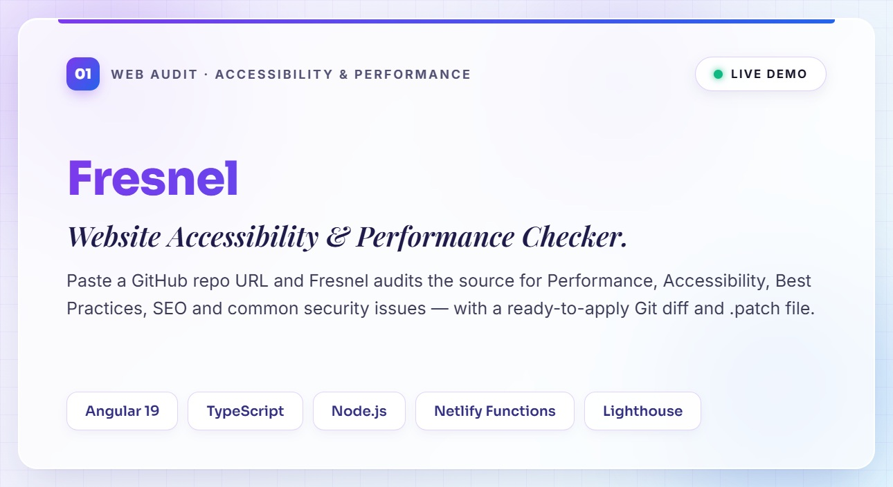
      </a>
      

        <a href="https://website-performance-checker.netlify.app/"><b>🌐 Live Demo</b></a> &nbsp;·&nbsp;
        <a href="https://github.com/jayashreemondal2005/Website-Accessibility-Performance-Checker"><b>💻 Code</b></a>
      

    </td>
    <td width="50%" valign="top">
      <a href="https://finance-story-managed-agent.netlify.app/" target="_blank">
        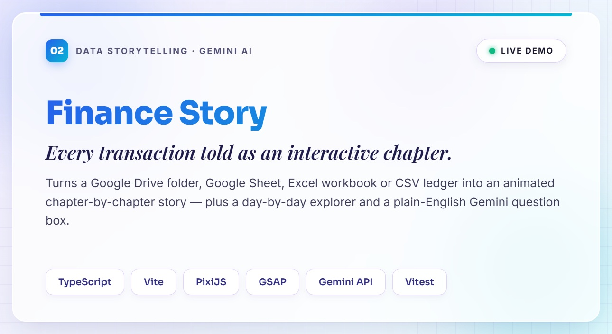
      </a>
      

        <a href="https://finance-story-managed-agent.netlify.app/"><b>🌐 Live Demo</b></a> &nbsp;·&nbsp;
        <a href="https://github.com/jayashreemondal2005/Finance-Story---Managed-Agent"><b>💻 Code</b></a>
      

    </td>
  </tr>
  <tr>
    <td width="50%" valign="top">
      <a href="https://github.com/jayashreemondal2005/Amazebot" target="_blank">
        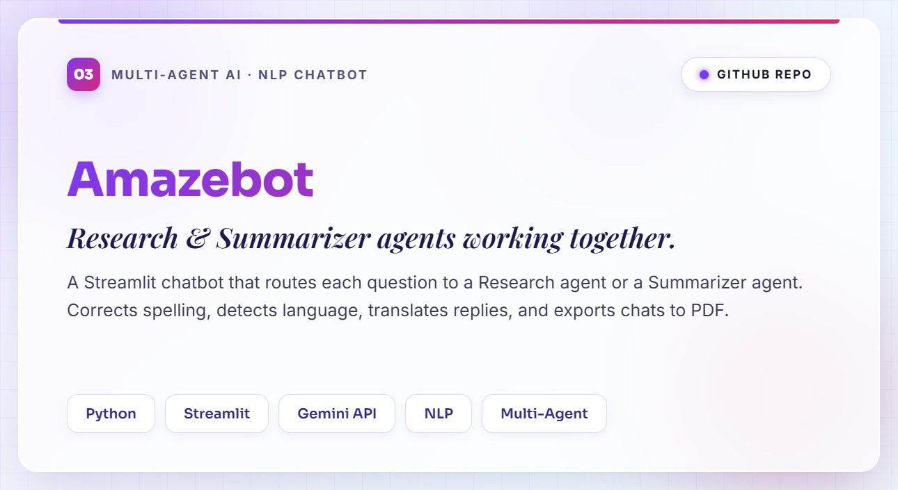
      </a>
      

        <a href="https://github.com/jayashreemondal2005/Amazebot"><b>💻 Code</b></a>
      

    </td>
    <td width="50%" valign="top">
      <a href="https://github.com/jayashreemondal2005/Face_mask_detection" target="_blank">
        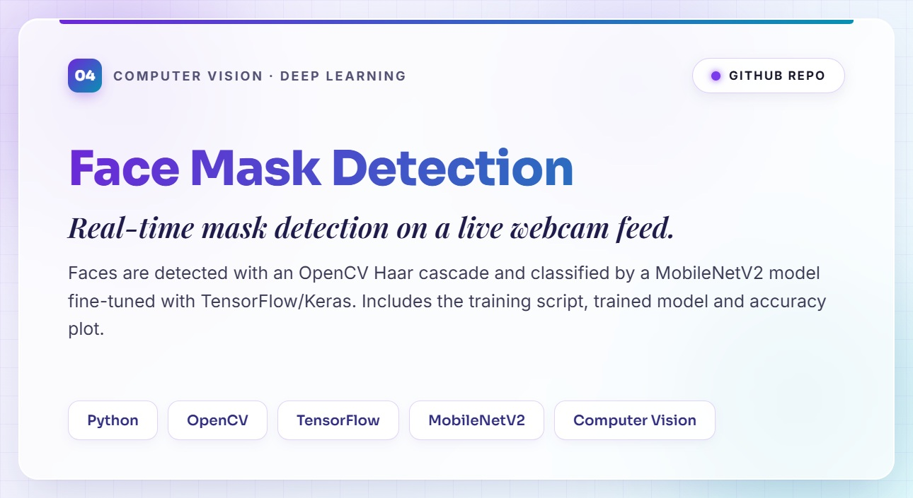
      </a>
      

        <a href="https://github.com/jayashreemondal2005/Face_mask_detection"><b>💻 Code</b></a>
      

    </td>
  </tr>
  <tr>
    <td width="50%" valign="top">
      <a href="https://online-examination-web-by-jayashree.netlify.app/" target="_blank">
        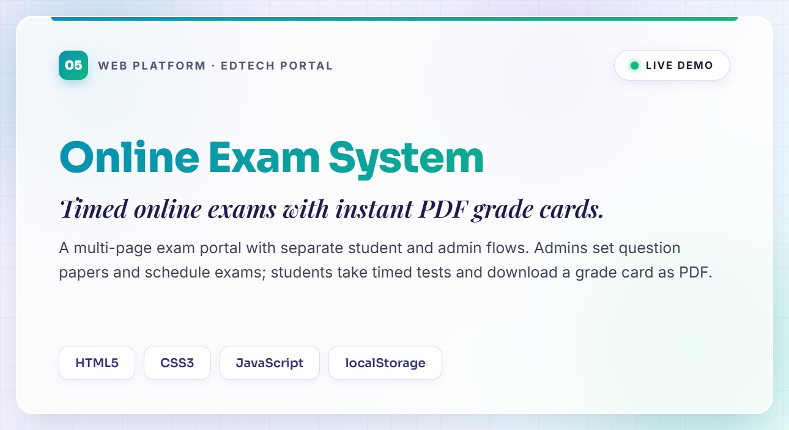
      </a>
      

        <a href="https://online-examination-web-by-jayashree.netlify.app/"><b>🌐 Live Demo</b></a> &nbsp;·&nbsp;
        <a href="https://github.com/jayashreemondal2005/Online_examination_system"><b>💻 Code</b></a>
      

    </td>
    <td width="50%" valign="top">
      <a href="https://jayashreemondal-portfolio.netlify.app/" target="_blank">
        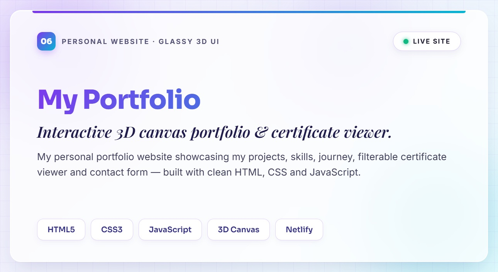
      </a>
      

        <a href="https://jayashreemondal-portfolio.netlify.app/"><b>🌐 Live Portfolio</b></a> &nbsp;·&nbsp;
        <a href="https://github.com/jayashreemondal2005/portfolio"><b>💻 Code</b></a>
      

    </td>
  </tr>
</table>

### 📂 Project Summary

| # | Project | Description | Tech Used | Links |
| :-: | :--- | :--- | :--- | :---: |
| **01** | **Fresnel — Accessibility & Performance Checker** | Audits a GitHub repo or Lighthouse JSON report for Performance, Accessibility, Best Practices, SEO and common security issues with ready-to-apply Git diffs and `.patch` export. | `Angular 19` `TypeScript` `Node.js` `Lighthouse` | [Live Demo](https://website-performance-checker.netlify.app/) · [Repo](https://github.com/jayashreemondal2005/Website-Accessibility-Performance-Checker) |
| **02** | **Finance Story — Managed Agent** | Turns a Google Sheet, Excel workbook or CSV ledger into an animated chapter-by-chapter story, day-by-day explorer, and plain-English Gemini question box. | `TypeScript` `Vite` `PixiJS` `GSAP` `Gemini API` | [Live Demo](https://finance-story-managed-agent.netlify.app/) · [Repo](https://github.com/jayashreemondal2005/Finance-Story---Managed-Agent) |
| **03** | **Amazebot — Multi-Agent Chatbot** | Streamlit chatbot routing questions to a Research agent or Summarizer agent with spelling correction, language detection, translation, and PDF chat export. | `Python` `Streamlit` `Gemini API` `NLP` | [Repo](https://github.com/jayashreemondal2005/Amazebot) |
| **04** | **Face Mask Detection** | Real-time mask / no-mask detection on a live webcam feed using OpenCV Haar cascades and a MobileNetV2 model fine-tuned in TensorFlow/Keras. | `Python` `OpenCV` `TensorFlow` `MobileNetV2` | [Repo](https://github.com/jayashreemondal2005/Face_mask_detection) |
| **05** | **Online Examination System** | Multi-page exam portal with Student and Admin flows, timed exams, auto-saved answers, question palette, instant grading, and PDF grade card download. | `HTML5` `CSS3` `JavaScript` `localStorage` | [Live Demo](https://online-examination-web-by-jayashree.netlify.app/) · [Repo](https://github.com/jayashreemondal2005/Online_examination_system) |
| **06** | **Personal Portfolio Website** | My portfolio website showcasing projects, skills, journey, filterable certificate viewer, and contact form. | `HTML5` `CSS3` `JavaScript` | [Live Site](https://jayashreemondal-portfolio.netlify.app/) · [Repo](https://github.com/jayashreemondal2005/portfolio) |

  

## 🛠️ Skills & Toolbox

  

     
    
  

| Category | Skills & Tools |
| :--- | :--- |
| **💻 Languages & Frameworks** | `Python` · `C++` · `Dart` · `Java` · `HTML5` · `CSS3` · `JavaScript` · `TypeScript` · `Flutter` · `React Native` · `Angular` · `Node.js` |
| **🧠 Core Competencies** | `Artificial Intelligence (AI)` · `Machine Learning (ML)` · `Computer Vision & NLP` · `Mobile App Development` · `Web Development` |
| **☁️ Tools & Cloud Platforms** | `TensorFlow` · `OpenCV` · `Streamlit` · `Gemini API` · `Oracle Cloud (OCI)` · `Microsoft Azure` · `Google Cloud` · `Vertex AI` · `Kaggle` · `Netlify` · `Git & GitHub` |
| **✨ Soft Skills** | `Problem Solving` · `Analytical Thinking` · `Adaptability` · `Quick Learning` · `Team Collaboration` · `Communication` |

  

## 🧭 My Journey

| Period | Role / Milestone | Organization | Details |
| :--- | :--- | :--- | :--- |
| **Jul 2026 – Oct 2026** | **Java Full Stack — TalentNext Program** | **Wipro TalentNext** | Completed Wipro's TalentNext course on Java Full Stack (Java, Spring Boot, SQL, and web development) under the Digital Skills Readiness Program. |
| **2025 – 2026** | **Independent Projects** | **Self-Directed** | Built and deployed Fresnel, Finance Story, Amazebot, Face Mask Detection, and the Online Examination System. |
| **Aug 2025 – Nov 2025** | **AI / ML Intern** | **EDU TANTR** | Completed an intensive AIML internship program and course, gaining practical exposure and hands-on skills in Artificial Intelligence & Machine Learning. |
| **2024 – 2025** | **Certifications & Cloud Programs** | **Oracle · IBM · Microsoft · Google · Kaggle** | Earned certifications in Generative AI, Cloud fundamentals, and Python — including the Google Gen AI Study Jam (16 badges). |
| **Ongoing** | **Hackathons — "Code Jam"** | **Code Vision Club, BCET** | 3-time registered participant in the "Code Jam" coding hackathon at Bengal College of Engineering & Technology. |
| **Aug 2023 – Jun 2027** | **B.Tech in Information Technology** | **BCET Durgapur** | Pursuing Bachelor of Technology in Information Technology (Graduation Batch: 2027). |

  

## 🎮 Arcade — Take a Break

Click any open square below to play **Violet X** against the bot — a GitHub Action updates the board automatically:

<!-- ARCADE:START -->

**Your turn — click any open square to play violet X against the bot.**

  <table>
    <tr><td></td><td></td><td></td></tr>
    <tr><td></td><td></td><td></td></tr>
    <tr><td></td><td></td><td></td></tr>
  </table>

Games played <b>6</b> &nbsp;·&nbsp; Visitors won <b>3</b> &nbsp;·&nbsp; Bot won <b>2</b> &nbsp;·&nbsp; Draws <b>1</b> 
Recent players: <a href="https://github.com/jayashreemondal2005">@jayashreemondal2005</a> 
<a href="https://github.com/jayashreemondal2005/jayashreemondal2005/issues/new?title=ttt%7Cnew&body=Just+press+%2A%2ACreate%2A%2A+and+the+board+updates+in+about+a+minute.+You+can+close+this+tab.">Start a fresh board</a>

<!-- ARCADE:END -->

  

## 📊 Activity & Stats

  <a href="https://jayashreemondal-portfolio.netlify.app/#certificates">
    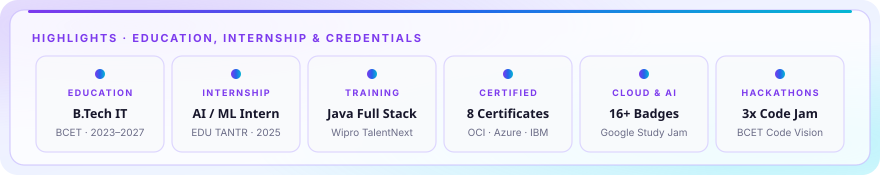
  </a>

    

  <a href="https://github.com/jayashreemondal2005">
    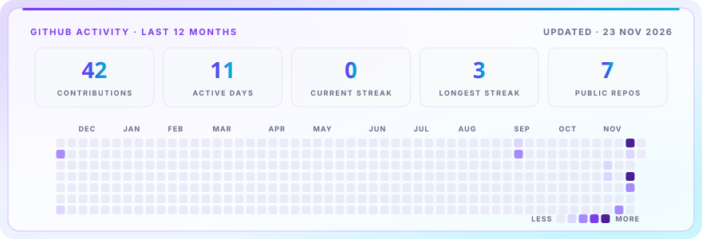
  </a>

    

  <table width="100%">
    <tr>
      <td width="50%" align="center">
        <a href="https://github.com/jayashreemondal2005?tab=repositories">
          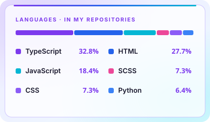
        </a>
      </td>
      <td width="50%" align="center">
        <a href="https://jayashreemondal-portfolio.netlify.app/">
          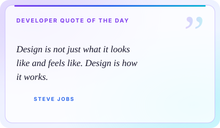
        </a>
      </td>
    </tr>
  </table>

   

  

    <b>🐍 24/7 Contribution Snake</b> 
    
  

  

## 🎖️ Licenses & Certifications

All 8 certificates can be viewed in full size on my **[live portfolio](https://jayashreemondal-portfolio.netlify.app/#certificates)**:

| Certificate / Badge | Issuer | Date | Skills / Credential |
| :--- | :--- | :---: | :--- |
| **Java Full Stack — TalentNext Program** | Wipro TalentNext | Jul – Oct 2026 | `Java` · `Spring Boot` · `SQL` (`TNext-SE-2026-J_260300174`) |
| **OCI 2025 Certified AI Foundations Associate** | Oracle University | Oct 2025 | `Oracle Cloud` · `Generative AI` (`102993945OCI25AICFA`) |
| **AI Fundamentals with Capstone Project** | IBM SkillsBuild | Oct 2025 | `Artificial Intelligence` · `ML` · `Capstone` |
| **Microsoft Certified: Azure Fundamentals** | Microsoft | Dec 2024 | `Azure` · `Cloud Computing` |
| **Google Gen AI Study Jam — Cohort 2** | Google Developer Groups · BCET | 2024 | `Google Cloud` · `Vertex AI` · `16 Skill Badges` |
| **Python Coder — Badge** | Kaggle | Nov 2025 | `Python` · `Coding` |
| **Artificial Intelligence — Internship** | EDU TANTR | Aug – Oct 2025 | `AI/ML` · `Practical Training` |
| **Artificial Intelligence — Course Completion** | EDU TANTR | 2025 | `AI Fundamentals` · `Machine Learning` |

  

## 📬 Get In Touch

  

    <b>Have an opportunity, project idea, or just want to say hi? My inbox is always open!</b>
  

  

    &nbsp;
    &nbsp;
    &nbsp;
    &nbsp;
    &nbsp;
    
  

  

    &nbsp;
    
  

  

    Designed &amp; built by <b>Jayashree Mondal</b> · Durgapur, West Bengal, India · <a href="https://jayashreemondal-portfolio.netlify.app/">jayashreemondal-portfolio.netlify.app</a>
  

